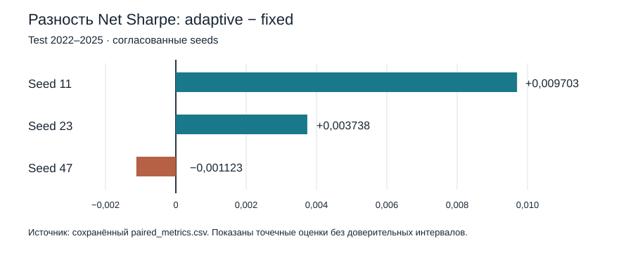

# Влияние адаптивного штрафа за торговый оборот на результаты PPO-стратегий управления портфелем акций

Первая полная содержательная версия, 18 ноября 2026 г. Данные об авторах, организации и научном руководителе: [ТРЕБУЕТ ПРОВЕРКИ]. Макет конкретной конференции не предоставлен.

## Аннотация

Исследуется сравнительная эффективность фиксированного и адаптивного штрафов за торговый оборот при управлении портфелем методом Proximal Policy Optimization (PPO). Цель — оценить финансовые результаты, торговую активность и устойчивость выбранных конфигураций при адаптации штрафа к исторической волатильности рынка. Использованы дневные данные Yahoo Finance для 12 американских акций; SPY служит индикатором рыночной волатильности. Обучение выполнено на периоде 2010–2018 гг., выбор конфигураций — на 2019–2021 гг., независимая оценка — на 1003 торговых датах 2022–2025 гг. Сопоставлены PPO без дополнительного штрафа, с фиксированным штрафом и с адаптивным штрафом при одинаковой комиссии 5 базисных пунктов и трёх согласованных seeds. Средняя парная разность Net Sharpe адаптивного и фиксированного вариантов составила +0,004106; 95%-й интервал парного stationary bootstrap равен [−0,002648; +0,010242]. Оборот и комиссии адаптивного варианта ниже во всех трёх seeds. Дополнительное снижение оборота в режиме высокой волатильности статистически не установлено. Преимущество адаптивной регуляризации по Net Sharpe не подтверждено; причинная интерпретация снижения оборота ограничена различием базовых коэффициентов штрафа.

Ключевые слова: обучение с подкреплением; PPO; управление портфелем; торговый оборот; адаптивная регуляризация; транзакционные издержки; историческая волатильность; блочный bootstrap.

## 1. Введение

Обучение с подкреплением позволяет рассматривать распределение капитала как последовательность решений с учётом состояния рынка и текущего портфеля. PPO использует ограничение изменения политики через clipped surrogate objective [1]. Применение подобных алгоритмов в финансах требует явного учёта торговых ограничений и издержек: увеличение числа перераспределений может уменьшать доходность после комиссий. В инфраструктуре FinRL транзакционные издержки включены в модель среды [2]; это подчёркивает необходимость оценивать экономический результат отдельно от функции обучения.

Дополнительный штраф за оборот изменяет стимулы агента. Фиксированный коэффициент задаёт постоянную цену торговой активности в reward, хотя состояние рынка меняется. Мотивация адаптивного коэффициента состоит в изменении этой цены в зависимости от исторической волатильности. Это проверяемое предположение: усиление штрафа может ограничить как избыточные сделки, так и полезную ребалансировку. Наличие волатильности в наблюдении само по себе также позволяет политике реагировать на рынок.

Цель работы — экспериментально оценить выбранные способы регуляризации при одинаковой финансовой среде. Задачи включают задание причинной оценки волатильности, сопоставление конфигураций на validation, независимую оценку финансовых метрик и анализ оборота в разных режимах. Основная гипотеза: выбранный по validation адаптивный вариант обеспечивает более высокий Net Sharpe на test, чем выбранный фиксированный вариант. Вторичный вопрос — сильнее ли снижается оборот адаптивного варианта в периоды высокой волатильности. Работа представляет ограниченное эмпирическое сравнение, а не доказательство новизны адаптивных функций вознаграждения как общего класса.

## 2. Связанные исследования

Schulman и соавторы [1] предложили семейство PPO и проверили его на задачах управления и игровых средах. Авторы сообщили благоприятное сочетание простоты реализации и эмпирической эффективности. Работа обосновывает выбор алгоритма, но не исследует портфельные комиссии или адаптацию штрафа за оборот.

Liu и соавторы [2] представили библиотеку FinRL для автоматизированной торговли, объединяющую финансовые среды, алгоритмы DRL, включая PPO, и оценку стратегий. Существенный результат — воспроизводимая программная инфраструктура с параметризуемыми издержками и ограничениями. В настоящей работе используется отдельная общая среда и узкое сравнение трёх reward-режимов; из FinRL не переносится утверждение об эффективности именно исследуемой адаптивной формулы.

Jiang, Xu и Liang [3] исследовали перераспределение криптовалютного портфеля с помощью детерминированного градиента политики, архитектуры EIIE и памяти портфельных весов. В трёх бэктестах с получасовой частотой предложенные нейросетевые варианты превосходили сравниваемые авторами стратегии с учётом заданной комиссии. Это предметный пример совместного рассмотрения весов и издержек; рынок, частота, алгоритм и функция обучения отличаются от настоящего эксперимента с PPO на дневных акциях.

Théate и Ernst [4] применили Trading Deep Q-Network и генерацию искусственных траекторий к торговле отдельными акциями. Их результаты неоднородны между инструментами: разделы 6.1–6.2 показывают успешный пример Apple и ограничения на Tesla, включая повышенную торговую частоту при выраженной волатильности. Это мотивирует анализ устойчивости и режимов, но не доказывает полезность адаптивного штрафа в диверсифицированном портфеле.

Таким образом, проверенные работы подтверждают актуальность последовательного управления и учёта издержек. Они не устанавливают преимущество исследуемого здесь коэффициента. Полнота обзора непосредственно адаптивных reward и регуляризации оборота остаётся ограничением первой версии; приоритет или отсутствие аналогов не заявляются.

## 3. Данные и метод

### 3.1. Выборка и временная причинность

Портфель включает AAPL, MSFT, JPM, JNJ, PG, HD, XOM, CAT, VZ, NEE, AMT и APD. Активы номинированы в USD; SPY используется отдельно для рыночного индикатора. Источник — Yahoo Finance через yfinance 0.2.65. Используется фиксированный снимок daily-v1, run `20261107T154124Z-9f1f7c1e`. Train охватывает 2010–2018 гг., validation — 2019–2021 гг., test — 2022–2025 гг.; данные с октября 2009 г. предназначены для прогрева признаков. Validation содержит 757 дат, test — 1003 даты, от 03.01.2022 до 31.12.2025.

Перед открытием дня t агент получает только завершённые бары по t−1. Рыночные признаки — сдвинутые на одну сессию простые close-to-close доходности и оценки волатильности. Наблюдение дополнено весами на предыдущем закрытии, NAV относительно начального капитала и долей оставшегося горизонта. Обучаемая нормализация наблюдений оценивается только на train и замораживается при оценке; reward не нормализуется. Известный остаток горизонта является допущением конечного эпизода и ограничивает перенос на непрерывную эксплуатацию.

Пусть ℓₛ = ln(Pₛᵃᵈʲ/Pₛ₋₁ᵃᵈʲ). Причинная оценка рыночной волатильности задаётся как

$$\sigma_t=\sqrt{\frac{252}{20}\sum_{s=t-20}^{t-1}\ell_s^2}. \tag{1}$$

Для адаптации используются доходности SPY. Это годовой нецентрированный RMS дневных логарифмических доходностей, а не внутридневная realized volatility и не выборочное стандартное отклонение. Опорное значение σ_ref — медиана train-оценок SPY, равная 0,11142612683693373. На validation и test оно не переоценивается. Скользящая σ продолжает обновляться из уже известных баров.

### 3.2. Торговая среда

Среда Gymnasium допускает long-only позиции, cash и дробные синтетические единицы без плеча. Начальный NAV равен 1000, портфель полностью состоит из cash; проценты на cash отсутствуют. Действие a имеет 13 компонент в [−1;1]. Оно преобразуется в неотрицательные оценки zᵢ=(clip(aᵢ,−1,1)+1)/2 и веса wᵢ=zᵢ/Σⱼzⱼ. Если все z равны нулю, устанавливается 100% cash. Это нормирование оценок, не softmax.

Исполнение производится по синтетическому adjusted Open[t], а переоценка — по adjusted Close[t]. Ночной результат принадлежит прежним позициям. Синтетическое открытие получается умножением vendor Open на фактор Adj Close/Close. Такая ретроспективная модель не воспроизводит отдельные исторические выплаты дивидендов и номинальную бухгалтерию splits; повторное начисление этих выплат не выполняется.

Пусть hᵢ — стоимость прежней позиции на открытии, V⁻ — NAV до сделки, c=5/10000. Бюджет B после комиссии определяется решением

$$B+c\sum_{i=1}^{12}|w_i B-h_i|=V^- . \tag{2}$$

Решение ищется бисекцией; сделки Δᵢ=wᵢB−hᵢ задают комиссию C=cΣᵢ|Δᵢ|. Оборот T=Σᵢ|Δᵢ|/V⁻ учитывает покупки и продажи рискованных активов, включая первоначальное инвестирование. Cash не считается отдельной комиссионной сделкой. Финальная ликвидация не производится. Проскальзывание, spread и market impact отсутствуют.

### 3.3. Вознаграждение и PPO

При NAV на закрытии V_t функция обучения имеет вид

$$u_t=\ln(V_t/V_{t-1})-\lambda_t T_t. \tag{3}$$

V_t уже содержит комиссию. Штраф λ_tT_t не списывается из NAV и не является второй комиссией. Сравниваемые правила приведены в таблице 1.

Таблица 1 — Выбранные на validation конфигурации

| Вариант | ID | λ₀ | α | Правило λ_t |
|---|---|---:|---:|---|
| Без штрафа | baseline | — | — | 0 |
| Фиксированный | f01 | 0,0001 | — | λ₀ |
| Адаптивный | a04 | 0,001 | +0,5 | clip(λ₀ min((σ_t/σ_ref)^α,5),0,0,01) |

Общая адаптивная сетка содержит также α=−0,5. Для отрицательного α отношение σ_t/σ_ref снизу ограничено 10⁻⁶; при α=0 helper точно возвращает фиксированный коэффициент. При выбранном α=+0,5 и нулевой σ штраф равен нулю. Ограничение 5 относится к множителю после возведения в степень.

Использована SB3 PPO 2.7.0 / MlpPolicy: отдельные actor и critic с двумя слоями по 64 нейрона и Tanh. Learning rate 0,0003; rollout 256; batch 64; 5 эпох; γ=0,99; GAE λ=0,95; PPO clip 0,2; entropy coefficient 0; value coefficient 0,5; max_grad_norm 0,5. Один DummyVecEnv, CPU, clip_obs=10. Оптимизатор и функция потерь PPO не модифицированы.

## 4. Экспериментальный протокол

Ограниченная сетка включает baseline, четыре fixed λ₀∈{0,0001;0,0003;0,001;0,003} и четыре adaptive — произведение λ₀∈{0,0003;0,001} и α∈{−0,5;+0,5}. Каждая конфигурация обучена с seeds 11, 23 и 47 по 16384 шага. Всего выполнено 27 запусков и 442368 шагов; 135 сохранённых checkpoints включают промежуточные и final и не являются независимыми запусками. Число 65536 в базовом ppo_pilot.json переопределено машинным планом пилота до 16384: объём исследования определяется разрешённым планом и отчётом batch.

В каждом семействе по максимальному среднему validation Net Sharpe всех трёх seeds выбран один кандидат; при точном равенстве применяется лексикографический ID. Использованы только final checkpoints, без выбора удачного seed. Число кандидатов одинаково, но конечные пространства поиска различаются. Validation-оценки после выбора имеют разведочный характер.

До открытия test сохранён decision_lock с SHA256 `e5691cf833454e05464892ccaa383c55a77fbfbc8f78187c344bbf81c07cfe43`. Записанное время фиксации 15.11.2026 12:57:30 UTC предшествует открытию test в 14:13:38 UTC; независимой подписи времени нет. Девять моделей оценены без нового обучения и настройки. Test не участвовал в выборе конфигураций, чтобы итоговая оценка не оптимизировалась под эту рыночную траекторию. После просмотра результатов период уже нельзя считать новым holdout.

Финансовые метрики вычисляются из простых net returns r_t=V_t/V_{t−1}−1. При K=252, N наблюдений и нулевой безрисковой ставке:

$$S=\sqrt{252}\,\overline r/s(r),\quad CAGR=(V_N/V_0)^{252/N}-1,\quad MDD=\max_t(1-V_t/\max_{0\le j\le t}V_j). \tag{4}$$

Стандартное отклонение имеет ddof=1. MDD — положительная величина потери; годовая волатильность равна √252 s(r), накопленная доходность — V_N/V_0−1. Финансовые метрики не рассчитываются по штрафованному reward.

Основная оценка — средняя парная разность S_adaptive−S_fixed по seeds. Парный stationary circular bootstrap использует 2000 повторов, seed 20261108 и ожидаемую длину блока L=20; L=10 и 40 предусмотрены для чувствительности. Общие временные индексы применяются ко всем политикам и seeds, в каждом повторе Sharpe пересчитывается. Seeds не ресэмплируются; интервалы условны на обученные политики и не оценивают весь разброс повторного обучения. Для вторичных сравнений нет одновременной корректировки; p-values не рассчитывались.

## 5. Результаты

В таблице 2 показаны результаты всех девяти моделей на test. Значения округлены из metrics_by_seed.csv; CAGR, волатильность, MDD и накопленная доходность даны в долях.

Таблица 2 — Финансовые метрики test 2022–2025

| Режим | Seed | Net Sharpe | CAGR | Годовая волатильность | MDD | Накопленная доходность |
|---|---:|---:|---:|---:|---:|---:|
| none | 11 | 0,506675 | 0,060277 | 0,132967 | 0,200598 | 0,262330 |
| none | 23 | 0,517768 | 0,065976 | 0,143161 | 0,212908 | 0,289554 |
| none | 47 | 0,538355 | 0,067283 | 0,138840 | 0,197521 | 0,295859 |
| fixed | 11 | 0,504989 | 0,060050 | 0,132994 | 0,200932 | 0,261255 |
| fixed | 23 | 0,517376 | 0,065863 | 0,143028 | 0,212553 | 0,289010 |
| fixed | 47 | 0,540823 | 0,067637 | 0,138813 | 0,197323 | 0,297571 |
| adaptive | 11 | 0,514693 | 0,061421 | 0,132999 | 0,199214 | 0,267760 |
| adaptive | 23 | 0,521115 | 0,066387 | 0,142913 | 0,212593 | 0,291533 |
| adaptive | 47 | 0,539700 | 0,067554 | 0,139009 | 0,196712 | 0,297170 |

Парные результаты таблицы 3 показывают неодинаковое направление финансовых различий между seeds.

Таблица 3 — Разности adaptive−fixed

| Seed | Δ Net Sharpe | Δ CAGR | Δ MDD |
|---|---:|---:|---:|
| 11 | +0,009703 | +0,001371 | −0,001718 |
| 23 | +0,003738 | +0,000524 | +0,000040 |
| 47 | −0,001123 | −0,000083 | −0,000612 |
| Среднее | +0,004106 | +0,000604 | −0,000763 |

Статистические оценки представлены в таблице 4. Основной интервал включает ноль, поэтому превосходство adaptive по Net Sharpe не установлено. Это не доказательство отсутствия эффекта или эквивалентности.

Таблица 4 — Парные 95%-е percentile интервалы

| Оценка | L | Точка | Нижняя граница | Верхняя граница |
|---|---:|---:|---:|---:|
| Δ Sharpe, весь test | 20 | +0,004106 | −0,002648 | +0,010242 |
| Δ Sharpe, чувствительность | 10 | +0,004106 | −0,002650 | +0,010561 |
| Δ Sharpe, чувствительность | 40 | +0,004106 | −0,001816 | +0,010057 |
| Δ Sharpe, high | 20 | +0,003038 | −0,004170 | +0,009532 |
| Δ Sharpe, low | 20 | +0,009485 | −0,009787 | +0,026668 |
| Δ оборота, high | 20 | −0,002376 | −0,002732 | −0,001981 |
| Δ оборота, low | 20 | −0,002127 | −0,002523 | −0,001791 |
| Взаимодействие оборота high−low | 20 | −0,000248 | −0,000792 | +0,000336 |

Режим high задан условием σ_t>σ_ref: 741 дата; low включает 262 даты. Условный Sharpe режима характеризует распределение отобранных дневных доходностей, а не отдельную непрерывную стратегию. CAGR и MDD по склеенным режимным дням не рассчитывались. Вторичная средняя разность Sharpe adaptive−none равна +0,004236, но её L=20 интервал [−0,002543;+0,010385] также включает ноль.

Таблица 5 показывает снижение оборота и комиссий adaptive относительно fixed для каждого seed. Средние парные разности равны −0,002311 доли pretrade NAV в день и −1,048594 денежной единицы соответственно. Это не означает, что fixed обязательно снижает оборот относительно none: при seed 11 он несколько выше.

Таблица 5 — Торговая активность и комиссии

| Режим | Seed | Средний дневной оборот | Суммарные комиссии при V₀=1000 |
|---|---:|---:|---:|
| none | 11 | 0,139014 | 71,779296 |
| none | 23 | 0,115482 | 60,345564 |
| none | 47 | 0,156095 | 82,934087 |
| fixed | 11 | 0,139686 | 72,087265 |
| fixed | 23 | 0,115135 | 60,135664 |
| fixed | 47 | 0,154839 | 82,292730 |
| adaptive | 11 | 0,135476 | 70,203364 |
| adaptive | 23 | 0,114100 | 59,697432 |
| adaptive | 47 | 0,153150 | 81,469081 |

Источник таблиц 2–5 — сохранённые Colab CSV попытки `20261115T141338Z-85cdf83a`; подробнее происхождение и границы проверки приведены в сопроводительной матрице. Графическое сравнение seeds дано на рисунке 1.

Рисунок 1 — Парные разности Net Sharpe adaptive−fixed по seeds. Источник: paired_metrics.csv, строки adaptive_minus_fixed / net_sharpe; назначение — показать неоднородность знака эффекта. Линия нуля не является границей статистической значимости.

## 6. Обсуждение и ограничения

Небольшая положительная средняя разность Sharpe сочетается с перекрывающим ноль интервалом. Меньшая комиссия сама по себе не гарантирует больший Sharpe: изменение сделок меняет экспозицию, доходность и риск. Возможные объяснения малой разности — небольшой масштаб штрафов, ограниченный бюджет обучения и сходство найденных политик. Это интерпретации, а не проверенные причины; диагностика сходимости и изолированные абляции не представлены.

У выбранного adaptive λ₀ в десять раз выше, чем у fixed. Сравнение оценивает результат процедуры выбора в конечных сетках, но не изолированный эффект формы адаптации при одинаковом базовом штрафе. Следовательно, снижение оборота нельзя целиком причинно приписать зависимости от σ. Хотя средний относительный оборот ниже в обоих режимах, интервал high−low взаимодействия содержит ноль. Неодинаковые эффекты по seeds и ограниченное число low-дней могут быть связаны с неопределённостью оценки; их причинная роль не установлена. Разведочный validation-результат о дополнительном снижении в high не получил статистического подтверждения на test.

Результаты согласуются с общей необходимостью учитывать издержки [2,3] и неоднородность поведения RL при меняющейся волатильности [4]. Они не являются прямым воспроизведением этих работ и не подтверждают универсальное превосходство регуляризации.

Всего три seeds недостаточно для надёжного описания распределения случайности обучения. Временной bootstrap условен на фиксированные политики и зависит от предпосылок о зависимости и устойчивости временного ряда; он не устраняет структурные сдвиги. Поиск ограничен девятью кандидатами и малым бюджетом; глобальный оптимум и сходимость PPO не установлены. Нет сопоставления с buy-and-hold или равновзвешенным портфелем, поэтому превосходство RL над простыми инвестиционными правилами не оценивается.

Современный состав известных выживших компаний создаёт survivorship и selection bias; делистинги не представлены. Yahoo Finance не является point-in-time архивом, данные могут пересматриваться. Синтетические adjusted prices используют ретроспективные корректировки и не заменяют модель дивидендных прав, дат выплат, налогов и корпоративных событий. Торговля дробными единицами по открытию без spread, slippage и impact идеализирована. RMS по 20 дням запаздывает и не описывает внутридневной риск. Один набор акций США и одна историческая test-траектория ограничивают перенос на другие рынки и режимы.

## 7. Заключение

Проведено сопоставление PPO без штрафа, с фиксированной и адаптивной регуляризацией оборота в общей торговой среде. После выбора по validation независимая оценка девяти моделей выявила среднюю разность Net Sharpe adaptive−fixed +0,004106 при 95%-м интервале [−0,002648;+0,010242]. Основная гипотеза о превосходстве адаптивного варианта не получила статистического подтверждения; эквивалентность методов также не установлена.

Адаптивная конфигурация характеризовалась меньшим оборотом и комиссиями во всех трёх seeds, однако причинная связь именно с адаптацией к рыночной волатильности не установлена из-за разных λ₀. Дополнительное снижение оборота в high-режиме не подтверждено. Дальнейшее исследование требует отдельного протокола, большего числа seeds, сравнения при согласованном масштабе штрафа, более реалистичной модели исполнения и новых независимых данных. Уже просмотренный test не должен использоваться для настройки и повторно объявляться нетронутой выборкой.

## Список цитируемой литературы

1. Schulman J., Wolski F., Dhariwal P., Radford A., Klimov O. Proximal Policy Optimization Algorithms. 2017. arXiv:1707.06347. DOI: [10.48550/arXiv.1707.06347](https://doi.org/10.48550/arXiv.1707.06347).
2. Liu X.-Y. et al. FinRL: A Deep Reinforcement Learning Library for Automated Stock Trading in Quantitative Finance. 2020. arXiv:2011.09607. DOI: [10.48550/arXiv.2011.09607](https://doi.org/10.48550/arXiv.2011.09607).
3. Jiang Z., Xu D., Liang J. A Deep Reinforcement Learning Framework for the Financial Portfolio Management Problem. 2017. arXiv:1706.10059. DOI: [10.48550/arXiv.1706.10059](https://doi.org/10.48550/arXiv.1706.10059).
4. Théate T., Ernst D. An Application of Deep Reinforcement Learning to Algorithmic Trading. 2020. arXiv:2004.06627. DOI: [10.48550/arXiv.2004.06627](https://doi.org/10.48550/arXiv.2004.06627).

Для электронных источников дата обращения: 18.11.2026. Указаны DOI препринтов, а не DOI журнальных версий.
